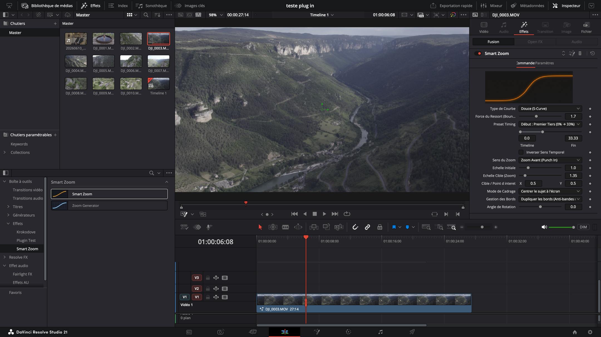
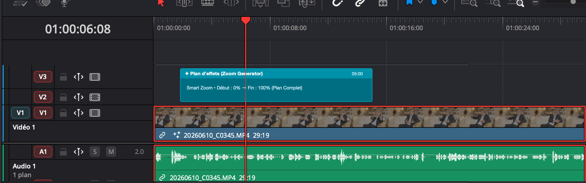
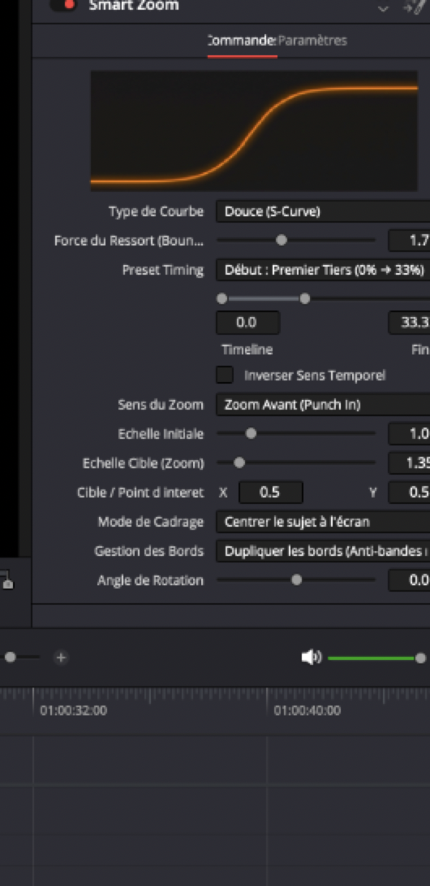
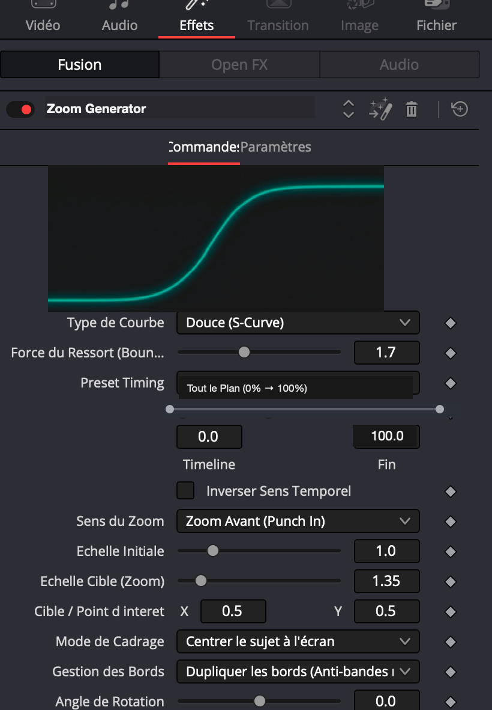

# ⚡ Smart Zoom Suite pour DaVinci Resolve

[](https://www.blackmagicdesign.com/products/davinciresolve)
[]()
[](LICENSE)
[]()
[](#-disclaimer--développement--ia)

> **La suite ultime de zooms cinématiques et dynamiques pour DaVinci Resolve (Page Montage).**  
> Zoomez avec précision, fluidité et style en un glisser-déposer, sans jamais poser une seule image-clé à la main !

<div align="center">
  
</div>

---

## 🎯 Aperçu des deux outils

La suite contient **deux outils complémentaires**, chacun pensé pour un flux de travail spécifique :

| Outil | Usage Principal | Couleur Graphique | Timing par défaut |
|---|---|---|---|
| 🟠 **Smart Zoom** | À glisser **directement sur votre clip vidéo** (Piste V1). Idéal pour dynamiser un début de phrase ou un cut. | **Ambre / Néon Orange** | Premier tiers (**0% → 33%**) |
| 🔵 **Zoom Generator** | À poser sur un **Plan d'effet (Adjustment Clip)** sur la piste du dessus (V2). Zoome tout ce qui se trouve en dessous sans toucher au rush original. | **Bleu Électrique / Cyan** | Tout le plan (**0% → 100%**) |

---

## ⚠️ RÈGLE D'OR : Comment utiliser le Zoom Generator

> [!IMPORTANT]
> **Le Zoom Generator nécessite obligatoirement un Plan d'effets (Adjustment Clip) !**
> Dans l'architecture de DaVinci Resolve, un effet ne peut pas être posé sur une piste vide. Pour utiliser **Zoom Generator** :
> 1. Allez dans **Boîte à outils** ➔ **Effets** ➔ Glissez un **Plan d'effet** (Adjustment Clip) sur la piste **V2** (au-dessus de votre vidéo sur V1).
> 2. Déposez l'effet **Zoom Generator** sur ce Plan d'effet.
> 3. Ajustez la longueur du Plan d'effet : le zoom s'adapte automatiquement à sa durée !



---

## ✨ Fonctionnalités Clés

### 1. 📈 Aperçu Graphique Haute Définition
Visualisez instantanément la courbe d'accélération sélectionnée directement dans votre Inspecteur. Pas de devinettes : vous voyez la dynamique du mouvement avant même d'appuyer sur Lecture.

<div align="center">
  <table>
    <tr>
      <td align="center"><b>Smart Zoom (Ambre)</b></td>
      <td align="center"><b>Zoom Generator (Bleu Électrique)</b></td>
    </tr>
    <tr>
      <td></td>
      <td></td>
    </tr>
  </table>
</div>

### 2. ⏱️ Timeline Interactive (`RangeControl`)
Plus besoin de taper des chiffres à l'aveugle :
- Une véritable **timeline miniature de 0 à 100 %** intégrée dans l'inspecteur.
- Déplacez la poignée **IN (Début)** et la poignée **OUT (Fin)** directement à la souris pour définir la zone exacte d'animation sur votre plan.
- Des **presets rapides** en 1 clic : *Premier Tiers (0-33%)*, *Première Moitié (0-50%)*, *Punch Central*, *Impact Flash*, *Tout le Plan (0-100%)*, etc.

### 3. 🌊 7 Courbes d'accélération professionnelles (Easing)
- ⚡ **Snap / Punchy** : Accélération explosive au début, décélération ultra douce. Parfait pour dynamiser un mot fort ou un face-caméra YouTube/TikTok.
- 🌊 **Douce (S-Curve)** : Transition soyeuse et cinématographique, idéale pour les documentaires et plans lents.
- 🚀 **Whip Zoom** : Accélération exponentielle ultra rapide pour transitions dynamiques au beat.
- 🎾 **Ressort (Bounce)** : Dépassement élastique de la cible avec calage naturel. *Force réglable via curseur dédié.*
- 📏 **Linéaire** : Vitesse constante mathématique.
- ⏳ **Accélération Lente** : Démarrage très doux qui prend de la vitesse sur la fin.
- 🔄 **Punch-In & Retour** : Zoom d'accentuation temporaire qui revient automatiquement au plan large (courbe en cloche).

### 4. 🔍 Cadrage Intelligent & Anti-Bandes Noires
- **Cible / Point d'intérêt :** Déplacez le réticule directement sur l'écran pour zoomer sur un visage ou un objet précis.
- **Mode de cadrage :** Choisissez de centrer le sujet au milieu de l'écran ou de conserver son emplacement d'origine.
- **Gestion des bords automatique :** Option *Dupliquer les bords* activée par défaut pour éliminer tout risque de bande noire lors des décentrements.
- **Rotation dynamique subtile :** Ajoutez une légère inclinaison angulaire synchronisée avec le zoom pour un rendu encore plus organique.

---

## 🚀 Installation

### Méthode 1 : Package `.drfx` en 1 clic (Recommandé)
1. Téléchargez le fichier **[`Smart Zoom.drfx`](Smart%20Zoom.drfx)** depuis la dernière release ou ce dépôt.
2. Double-cliquez dessus.
3. DaVinci Resolve s'ouvre et vous demande si vous souhaitez installer le pack de modèles. Cliquez sur **Install**.
4. C'est prêt !

---

### Méthode 2 : Script automatique (Terminal)

#### Sur macOS / Linux :
Ouvrez votre terminal dans le dossier téléchargé et lancez :
```bash
chmod +x install.sh
./install.sh
```

#### Sur Windows :
Double-cliquez simplement sur **`install.bat`**.

---

### Méthode 3 : Installation Manuelle

Copiez les fichiers aux emplacements suivants selon votre système :

#### macOS :
- Moteur : Copier `src/Fuses/SmartZoom.fuse` dans :  
  `~/Library/Application Support/Blackmagic Design/DaVinci Resolve/Fusion/Fuses/`
- Effets : Copier le dossier `src/Templates/Edit/Effects/Smart Zoom/` dans :  
  `~/Library/Application Support/Blackmagic Design/DaVinci Resolve/Fusion/Templates/Edit/Effects/`

#### Windows :
- Moteur : Copier `src\Fuses\SmartZoom.fuse` dans :  
  `%APPDATA%\Blackmagic Design\DaVinci Resolve\Support\Fusion\Fuses\`
- Effets : Copier le dossier `src\Templates\Edit\Effects\Smart Zoom\` dans :  
  `%APPDATA%\Blackmagic Design\DaVinci Resolve\Support\Fusion\Templates\Edit\Effects\`

---

## 🛠️ Utilisation Pas à Pas

1. Rendez-vous sur la **Page Montage (Edit)** de DaVinci Resolve.
2. Ouvrez le panneau **Boîte à outils** ➔ **Effets** ➔ dossier **Smart Zoom**.
3. **Cas 1 (Sur un clip précis) :** Glissez l'effet **Smart Zoom** directement sur votre vidéo.
4. **Cas 2 (Sur plusieurs pistes ou un plan global) :** Glissez un **Plan d'effet** sur V2, puis glissez **Zoom Generator** dessus.
5. Ouvrez l'**Inspecteur** (en haut à droite) ➔ onglet **Effets** :
   - Choisissez votre **Type de Courbe**.
   - Ajustez la **Timeline** ou choisissez un **Preset**.
   - Ajustez l'**Échelle Cible** et le **Point d'intérêt**.

---

## 🤖 Disclaimer / Développement & IA

Ce projet a été conçu, codé et optimisé en **pair-programming avec une assistance par Intelligence Artificielle**.
L'ensemble de l'architecture, du code Lua (`.fuse`), des calculs mathématiques des courbes d'accélération (Bézier / Spring physics) et des templates de macro DaVinci Resolve ont été développés, testés en conditions réelles et validés sur DaVinci Resolve Studio pour garantir une stabilité et des performances GPU maximales.

---

## 📜 Licence

Ce projet est sous licence **MIT** - voir le fichier [LICENSE](LICENSE) pour plus de détails. Vous êtes libre de l'utiliser, le modifier et le partager pour vos projets personnels ou commerciaux.
